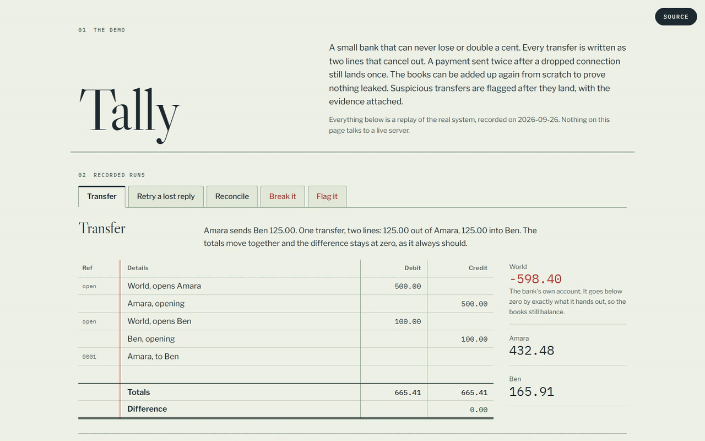
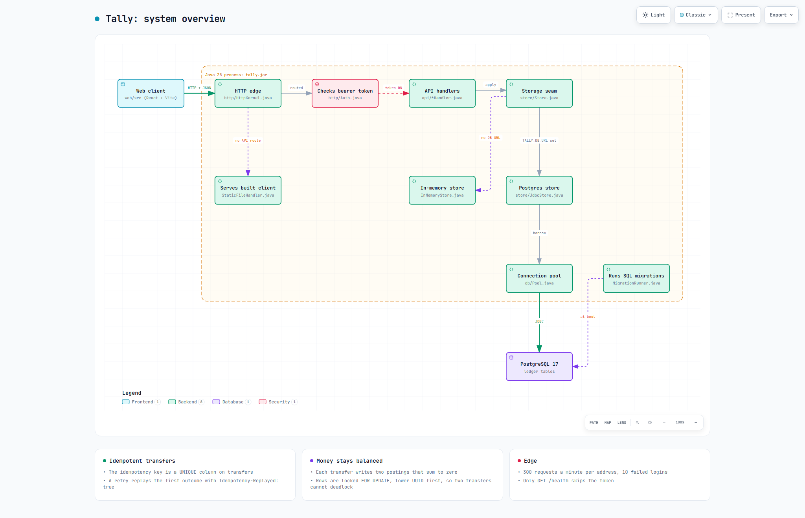
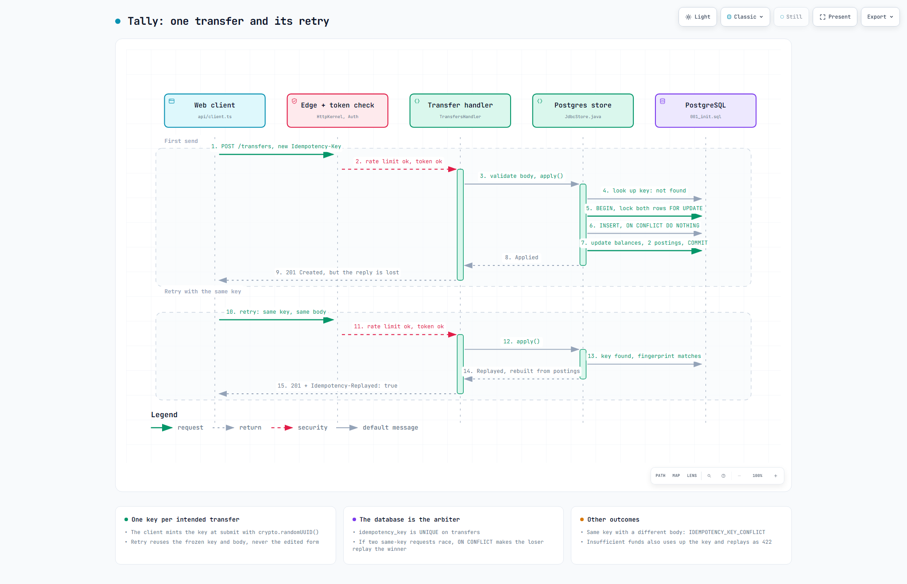
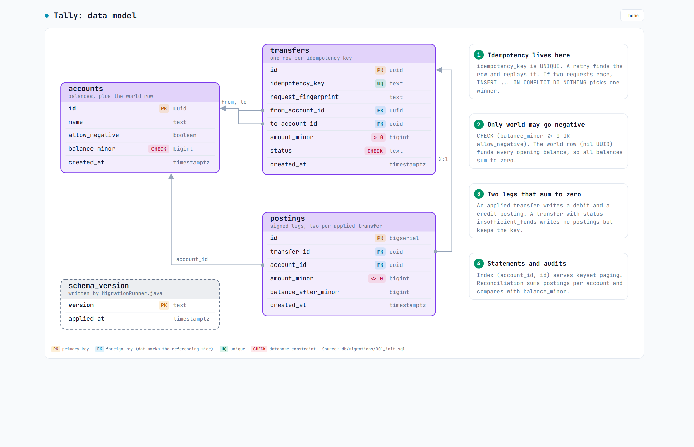
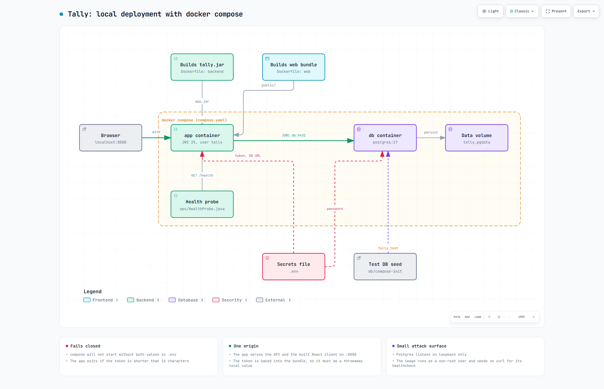
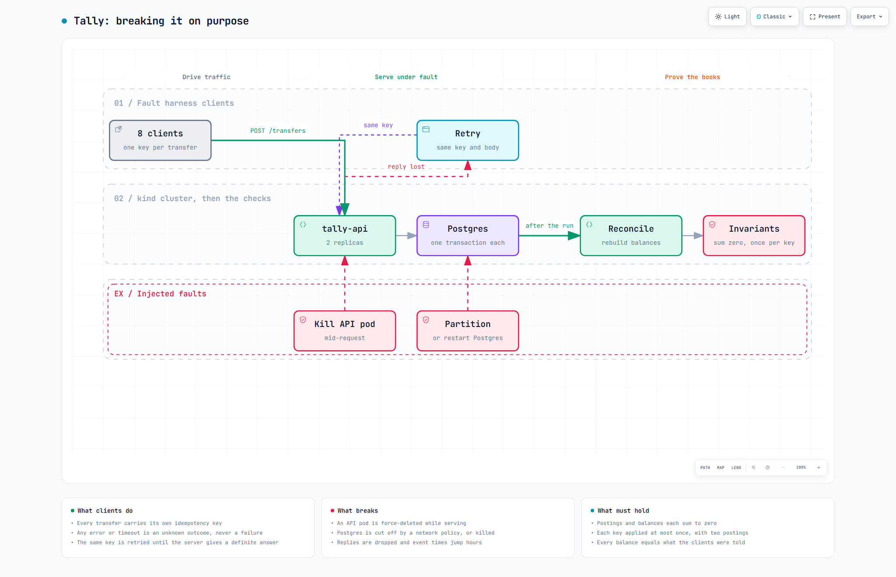
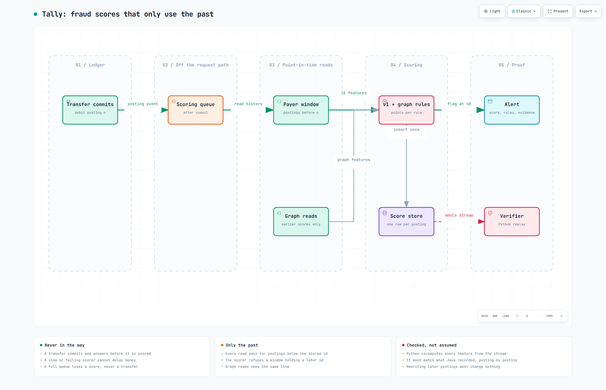
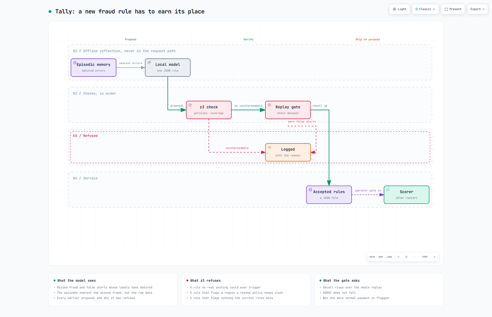

# Tally

Tally is a small bank that never loses or doubles a cent. The bank writes each transfer as two entries that cancel out. If a connection drops and an app sends a transfer again, the bank applies it only once. The bank can total every balance again from the start to prove that no money leaked. A fraud check looks at each transfer after the bank saves it, and each alert keeps its evidence.

**Demo:** [samad-zeeshan.github.io/Tally](https://samad-zeeshan.github.io/Tally/) plays back runs from the real service. The runs show a transfer, a retry after a lost reply, a recount of the books, a crash test, and a fraud alert. In the last run, the fraud check flags a chain of accounts that pass stolen money along. A 90-second walkthrough is in [docs/media/demo.mp4](docs/media/demo.mp4).



## How it works

A Java service on the JDK's HTTP server writes each transfer to Postgres in one transaction. Later, a fraud scorer reads the saved entries, outside the path of the request.

-  This diagram shows the parts of the service and how it picks Postgres or an in-memory store at startup.
-  The bank applies a transfer, the reply gets lost, and a retry with the same transfer reference gets the saved result.
-  This diagram shows the ledger tables and the database constraints that enforce the same rules as the code.
-  This diagram shows what runs where, on a laptop and on a local Kubernetes cluster made with kind.
-  The crash test breaks the cluster while clients send transfers, and then it checks the books.
-  Each fraud score uses only entries saved before it, and a separate checker proves this.
-  A local model can propose a rule, but the rule must pass a z3 check and a full replay before anyone can enable it.

Each diagram has an interactive version beside it in `docs/diagrams/`.

## Why it is correct

The project states the ledger rules in four ways:

- A TLA+ model in `spec/Ledger.tla` follows `JdbcStore.apply` one statement at a time. The model has two workers and three clients whose transfers cross. It adds crashes that undo a transaction, lost messages, and retries that race the first copy.
- Postgres enforces the same rules as constraints. Each transfer reference (the idempotency key) must be unique. Only the world account may go below zero, and no entry may be zero.
- The crash test breaks a real cluster. Then it compares Postgres with the answer that each client got.
- A recount (reconciliation) rebuilds every balance from its entries on request.

<!-- gen:spec -->
| Model | Expected | Result | Situations checked | Rule broken |
|---|---|---|---|---|
| the real protocol | pass | pass | 394,177 | none |
| duplicate check removed | violation | violation | 20,301 | ExactlyOnce |
<!-- /gen -->

The model checks the protocol, not the Java code. It leaves out the in-memory store, the connection pool, and several API copies that share one database. In the model, money is a small integer and not a `long`. The code and the model can share the same mistake. The paper arXiv 2607.05076 warns about this gap, so the crash tests below give a second check.

<!-- gen:faults -->
| Fault | Transfers | Retries | Money created or lost | Applied twice | Nobody asked for it | Confirmed but lost | Recount agrees | Longest wait for an answer |
|---|---|---|---|---|---|---|---|---|
| none | 1,958 | 0 | 0 | 0 | 0 | 0 | yes | 0.2 s |
| server stopped | 2,123 | 25 | 0 | 0 | 0 | 0 | yes | 3.2 s |
| database restart | 1,185 | 155 | 0 | 0 | 0 | 0 | yes | 10.1 s |
| database cut off | 939 | 32 | 0 | 0 | 0 | 0 | yes | 15.2 s |
| clocks out of step | 2,082 | 0 | 0 | 0 | 0 | 0 | yes | 0.1 s |
| replies dropped | 1,742 | 698 | 0 | 0 | 0 | 0 | yes | 0.2 s |
| several at once | 1,025 | 670 | 0 | 0 | 0 | 0 | yes | 12.1 s |
<!-- /gen -->

<!-- gen:faults-summary -->
Every check passed in all 7 crash tests, so the bank did not lose or double any money. The runs made about 11,000 transfers and about 1,600 retries.
<!-- /gen -->

Each run sends transfers until all its faults are over and every client has a clear answer. A fault that no request noticed fails the run. To cut off the database, the test adds a NetworkPolicy and closes the open connections from the database side. These runs used kind on Docker Desktop on one Windows laptop. CI runs them again on every push, as a fifth gate after the four deployment gates.

The first runs found five real bugs. Each one now has a fix and a test:

- Transfers and fraud score inserts could deadlock on the same account rows.
- The pool did not replace a connection that a Postgres restart broke, when a request gave the connection back.
- The pool also did not replace a broken connection when a request borrowed it. Together, these two bugs left one server with no connections.
- A database cut left every pooled connection to wait forever on a read.
- A stale DNS cache kept the API on a dead database pod for a minute.

The last column of the crash test table shows the longest time in which no client got any answer. That is what an outage looks like from outside.

<!-- gen:load -->
| Operation | Time limit, slowest 1 in 100 | Highest steady load | Typical (`p50`) | Slowest 1 in 20 (`p95`) | Slowest 1 in 100 (`p99`) |
|---|---|---|---|---|---|
| transfer | 100 ms | 100 req/s | 17.1 ms | 63.6 ms | 77.8 ms |
| statement | 100 ms | 100 req/s | 10.2 ms | 59.2 ms | 77.7 ms |
| reconciliation | 1000 ms | 10 req/s | 371.7 ms | 568.1 ms | 672.7 ms |
<!-- /gen -->

All three operations stayed inside their time limits at the loads in the table. The load test measures each delay from the planned send time, so the delay includes time in the queue. The test ran on the same laptop as the cluster. These numbers describe this one setup. They are not a capacity plan.

## Fraud check

The fraud check scores every transfer after the bank saves it. The first version (v1) uses rules about the payer's own history. The second version (v2) adds rules about the web of transfers around each one:

- a burst of money to an account that nobody else pays,
- flagged money that moves on within the hour,
- money that comes back within a day,
- fewer points when many accounts already pay the payee.

Each score keeps every input value, the points from each rule, and the earlier entries that it used. The test data comes from a random generator with a fixed seed. It holds four kinds of fraud, and the test sends all of it through the real API:

- bursts of money to one new payee,
- structuring, which is many small transfers that stay under a limit,
- account takeover,
- mule chains, which are accounts that pass stolen money along.

<!-- gen:fraud -->
| At the flag line of 40 | v1 rules | v2 with graph rules |
|---|---|---|
| Flags that were fraud (`precision`) | 0.3496 | 0.8366 |
| Fraud that got flagged (`recall`) | 0.4314 | 0.8562 |
| Ranking quality, 1 is perfect (`AUROC`) | 0.9055 | 0.9883 |
| Normal transfers flagged | 240 of 8,991 | 50 of 8,991 |
| Alerts per 1,000 transfers | 39.72 | 32.94 |
| `precision` and `recall` on new data, seed 20260926 | 0.3655 / 0.4375 | 0.8179 / 0.8562 |
<!-- /gen -->

<!-- gen:patterns -->
| Kind of fraud | v1 `precision` at its `recall` | v2 `precision` at the same `recall` | v1 `AUROC` | v2 `AUROC` | v2 `recall` at 40 |
|---|---|---|---|---|---|
| burst | 0.0204 at 0.0394 | 0.8769 | 0.8722 | 0.9746 | 0.7165 |
| structuring | 0.2453 at 1 | 0.7647 | 0.9933 | 0.9986 | 1 |
| account takeover | 0.0698 at 0.72 | 0.3158 | 0.9906 | 0.9979 | 0.72 |
| mule chain | 0.1045 at 0.4058 | 0.8621 | 0.837 | 0.9983 | 1 |
<!-- /gen -->

<!-- gen:fraud-summary -->
The test data holds about 9,300 transfers between about 360 accounts, from seed 20260925. For bursts, the share of flags that were real fraud went from about 2 percent to about 88 percent. That is a large gain. This compares the two versions where each catches the same share of bursts, about 3.9 percent. Across all kinds of fraud, flags on normal transfers fell from 240 to 50. Fewer is better.
<!-- /gen -->

The graph rules came from a study of this same data, so trust the row with new data more. Account takeover is still the weak spot, and its row shows it. The rule for money that comes back fired only on normal transfers, because the test data has no loops.

<!-- gen:pit-summary -->
A separate checker in Python computed all 16 inputs again for every transfer, about 9,300 in all. It found no difference from the Java scorer. The checker also changed the future for 200 sample transfers. No score changed, so no score used data from after its transfer. The slowest 1 in 100 explanations took about 92 microseconds to build. The limit is 50 ms, so this is far inside it.
<!-- /gen -->

New rules come from a separate offline step. A local model (`qwen/qwen3.5-9b` in LM Studio) reads past mistakes that look like the missed fraud. It also reads every earlier proposal and its result. It then answers with one rule as JSON, and a schema checks the format. Next, z3 looks for a case that breaks either of two written policies. It also refuses a rule that can never fire or that adds nothing new.

A full replay of the test data makes the final decision. An accepted rule still does nothing until an operator names its file in `TALLY_FRAUD_EXTRA_RULES`.

<!-- gen:reflection -->
| Run | Proposed rule | z3 check | Full replay |
|---|---|---|---|
| 1 | `distinct_payees_60m == 1`, 25 points | rejected (contradicts policy) | not run |
| 2 | `amount_minor >= 25000`, 15 points | passed | rejected (flagged normal postings rose from 50 to 229) |
| 3 | `amount_to_median_x100 >= 250`, 15 points | rejected (contradicts policy) | not run |
<!-- /gen -->

## Design decisions

- The code stores money as a `long` count of cents everywhere. It uses no floats, it checks every sum for overflow, and the JSON parser refuses fractions.
- A reserved world account pays the first deposit into each new account. It is the only account that may go below zero. So money that enters the bank also makes two entries that agree.
- The unique reference in Postgres decides which transfer is a repeat. This stays true across restarts and across server copies. A lock inside one process cannot do that.
- The code locks account rows in one fixed order, so two transfers in opposite directions cannot deadlock. The lock is `FOR NO KEY UPDATE`, so fraud score inserts never wait for it.
- The service uses no framework, because its surface is small and fixed. It writes its own JSON and its own Prometheus metrics. It runs on the JDK's HTTP server with virtual threads, and plain Kustomize files deploy it.
- The fraud check runs after commit, from a queue with a fixed size. A slow or broken scorer can lose a score, but never a transfer.

## Run it

```
cp .env.example .env && docker compose up --build   # the app on localhost:8080, fill in .env first
./mvnw -Pintegration verify                          # unit tests, plus Postgres tests if TALLY_TEST_DB_URL is set
make k8s-up && make k8s-gates && ./scripts/k8s-faults.sh   # kind cluster, four gates, fault gate
```

These scripts rebuild the results files: `python eval/fraud/run.py`, `python spec/check.py` and `python eval/load/run.py`. Then `python eval/report.py` writes every table above again from those files.

## Papers

- arXiv 2607.05076, Can Code Specify a System Precisely Enough to Formally Verify It? It shaped the model of the transfer protocol and its list of gaps.
- arXiv 2609.27571, FDE-Bench. It gave the four deployment gates, and this project adds fault behaviour as a fifth.
- arXiv 2608.22389, KONTOGRAPH. It gave the point-in-time inputs, the checker that rewrites the future, and the timed explanations.
- arXiv 2608.23468, RAD. It combines rules with signals from the web of transfers.
- arXiv 2607.27267, FAVA. Every alert carries the evidence that made it fire.
- arXiv 2609.24446, ActGov. Every rule change gets a counterexample check from an SMT solver.
- arXiv 2609.28771, Agent Memory with Episodic Retrieval for Financial Decision-Making. The offline step keeps a memory of past mistakes in this way.
- arXiv 2609.27287, SR-Fraud. It uses a fixed scorer, an offline step that learns from mistakes, and a gate that always gives the same answer.
- arXiv 2609.18270, BENCHCOMPASS. The model gets evidence as typed summaries, not raw records.
- arXiv 2609.19928, semantic user profiling at bank scale. The offline step looks at groups of similar mistakes, not one account at a time.

## Licence

Tally uses the MIT licence. See [LICENSE](LICENSE).
